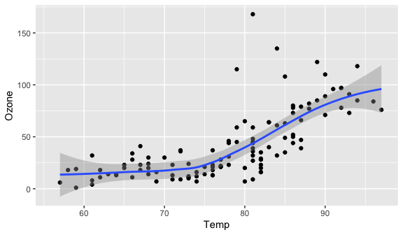
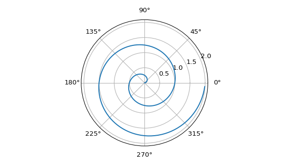

# Test Quarto via mkdocs

This is a simple example that uses python

You can take a look at the .qmd that generated this docs from:

<https://github.com/jspaezp/mkquartodocs/tree/main/docs>

<!-- more -->

## Hello

Here is some text

:::: cell
::: {.cell-output .cell-output-stdout}
    Hello World
:::
::::

Here is how warnings look

:::: cell
::: {.cell-output .cell-output-stdout}
    <string>:1: UserWarning: This is a warning
:::
::::

Some python logic

:::: cell
::: {.cell-output .cell-output-stdout}
    ['1', '2', 'Fizz', '4', 'Buzz', 'Fizz', '7', '8', 'Fizz', 'Buzz', '11', 'Fizz', '13', '14', 'FizzBuzz', '16', '17', 'Fizz', '19', 'Buzz', 'Fizz', '22', '23', 'Fizz', 'Buzz', '26', 'Fizz', '28', '29', 'FizzBuzz', '31', '32', 'Fizz', '34', 'Buzz', 'Fizz', '37', '38', 'Fizz', 'Buzz', '41', 'Fizz', '43', '44', 'FizzBuzz', '46', '47', 'Fizz', '49', 'Buzz', 'Fizz', '52', '53', 'Fizz', 'Buzz', '56', 'Fizz', '58', '59', 'FizzBuzz', '61', '62', 'Fizz', '64', 'Buzz', 'Fizz', '67', '68', 'Fizz', 'Buzz', '71', 'Fizz', '73', '74', 'FizzBuzz', '76', '77', 'Fizz', '79', 'Buzz', 'Fizz', '82', '83', 'Fizz', 'Buzz', '86', 'Fizz', '88', '89', 'FizzBuzz', '91', '92', 'Fizz', '94', 'Buzz', 'Fizz', '97', '98', 'Fizz', 'Buzz']
:::
::::

Some pretty printing

:::: cell
::: {.cell-output .cell-output-stdout}
    ['1',
     '2',
     'Fizz',
     '4',
     'Buzz',
     'Fizz',
     '7',
     '8',
     'Fizz',
     'Buzz',
     '11',
     'Fizz',
     '13',
     '14',
     'FizzBuzz',
     '16',
     '17',
     'Fizz',
     '19',
     'Buzz',
     'Fizz',
     '22',
     '23',
     'Fizz',
     'Buzz',
     '26',
     'Fizz',
     '28',
     '29',
     'FizzBuzz',
     '31',
     '32',
     'Fizz',
     '34',
     'Buzz',
     'Fizz',
     '37',
     '38',
     'Fizz',
     'Buzz',
     '41',
     'Fizz',
     '43',
     '44',
     'FizzBuzz',
     '46',
     '47',
     'Fizz',
     '49',
     'Buzz',
     'Fizz',
     '52',
     '53',
     'Fizz',
     'Buzz',
     '56',
     'Fizz',
     '58',
     '59',
     'FizzBuzz',
     '61',
     '62',
     'Fizz',
     '64',
     'Buzz',
     'Fizz',
     '67',
     '68',
     'Fizz',
     'Buzz',
     '71',
     'Fizz',
     '73',
     '74',
     'FizzBuzz',
     '76',
     '77',
     'Fizz',
     '79',
     'Buzz',
     'Fizz',
     '82',
     '83',
     'Fizz',
     'Buzz',
     '86',
     'Fizz',
     '88',
     '89',
     'FizzBuzz',
     '91',
     '92',
     'Fizz',
     '94',
     'Buzz',
     'Fizz',
     '97',
     '98',
     'Fizz',
     'Buzz']
:::
::::

:::: cell
::: {.cell-output .cell-output-stdout}
    NotImplementedError
:::
::::

## R plot

[Figure 1](#fig-airquality){.quarto-xref} further explores the impact of
temperature on ozone level.

:::: cell
::: cell-output-display

:::
::::

## Python plot

For a demonstration of a line plot on a polar axis, see
[Figure 2](#fig-polar){.quarto-xref}.

:::: cell
::: cell-output-display
{width="576"}
:::
::::
